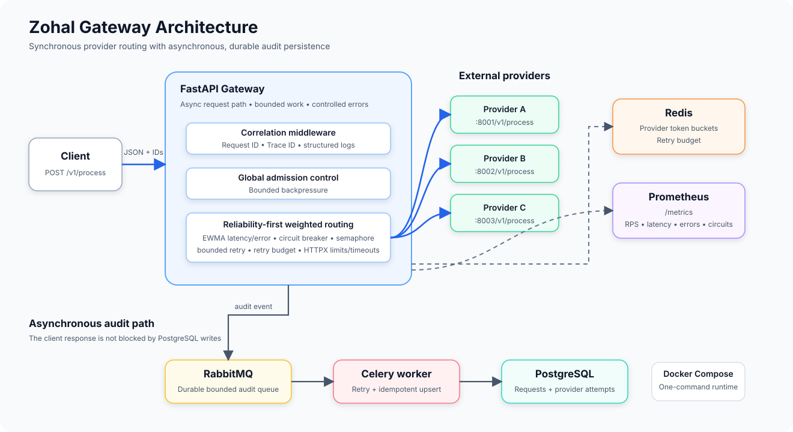

# Zohal

**A resilient API gateway for routing requests across multiple providers.**

Zohal is a FastAPI gateway that forwards JSON requests to one of three upstream providers. It combines load-aware routing with rate limiting, bounded retries, circuit breakers, and asynchronous audit persistence.


## Highlights

- **Load-aware routing:** selects an eligible provider using recent errors, latency, and in-flight load.
- **Resilience:** applies per-process circuit breakers, provider concurrency limits, a request deadline, and at most one retry to a different provider.
- **Traffic protection:** uses Redis token buckets and a bounded admission queue to reject excess work rather than accept unlimited load.
- **Asynchronous audit:** publishes compact request and attempt metadata to RabbitMQ; a Celery worker writes it to PostgreSQL with idempotent upserts.
- **Observability:** exposes Prometheus metrics, structured JSON logs, health endpoints, and request/trace correlation headers.

## Architecture



The gateway makes upstream calls directly. RabbitMQ and Celery are used for audit persistence, not provider calls. Redis holds shared rate-limit state; routing statistics and circuit breakers are local to each API process. See the [architecture guide](docs/architecture.md) for the request flow and operational trade-offs.

## Quick start

**Prerequisite:** Docker Desktop with Docker Compose v2. Run the following from the project root:

```sh
docker compose up --build -d
```

Compose starts the API, PostgreSQL, Redis, RabbitMQ, the audit worker, and a migration job. The API listens on port `8000`.

```sh
curl --fail http://localhost:8000/health/live
curl --fail http://localhost:8000/health/ready
```

Send a JSON object to the gateway:

```sh
curl -i http://localhost:8000/v1/process \
  -H 'Content-Type: application/json' \
  -H 'X-Request-ID: example-request-1' \
  -H 'X-Trace-ID: example-trace-1' \
  --data '{"value":"hello"}'
```

**Provider traffic:** the default provider URLs use the reserved `example.invalid` domain and are not working endpoints. Set all three provider URL overrides before sending requests to `/v1/process`. Use endpoints you are authorized to call and avoid sending sensitive data to an untrusted provider. The bundled Compose credentials are for local development only.

Stop the stack with `docker compose down`. Add `-v` only when you intend to delete its persisted data.

## API

| Endpoint | Purpose |
| --- | --- |
| `POST /v1/process` | Routes a JSON object to an eligible provider and returns its JSON response or a controlled gateway error. |
| `GET /health/live` | Checks that the API process is running. |
| `GET /health/ready` | Pings Redis and reports whether RabbitMQ and PostgreSQL are configured; it does not test their connectivity or upstream provider health. |
| `GET /metrics` | Exposes Prometheus metrics. |

Responses include `X-Request-ID` and `X-Trace-ID`. Forwarded responses also identify the provider with `X-Upstream-Provider`. Depending on the failure, the gateway returns controlled `429`, `502`, `503`, or `504` responses. The [architecture guide](docs/architecture.md) describes routing, retry, and failure behavior.

## Configuration

Settings are read from environment variables or a local `.env` file. Key options include:

| Variables | Purpose |
| --- | --- |
| `PROVIDER_A_URL`, `PROVIDER_B_URL`, `PROVIDER_C_URL` | Configure the three upstream endpoints; defaults are non-working examples. |
| `REDIS_URL` | Redis connection for rate limiting and readiness. |
| `RABBITMQ_URL` | Celery audit broker connection. |
| `DATABASE_URL` | PostgreSQL audit database connection. |
| `REQUEST_DEADLINE_SECONDS` | Overall time budget shared by provider attempts. |
| `MAX_INFLIGHT`, `ADMISSION_WAIT_MS` | Global concurrency and bounded admission wait. |
| `PROVIDER_{A,B,C}_RATE_CAPACITY`, `PROVIDER_{A,B,C}_RATE_REFILL_RPS` | Per-provider token-bucket limits. |
| `PROVIDER_{A,B,C}_MAX_CONCURRENT` | Per-provider concurrency limits. |

See [application settings](app/config.py) and the [Compose configuration](docker-compose.yml) for defaults and connection-pool settings. Do not commit credentials or private environment files.

## Development and testing

For local Python tests, use Python 3.12 and a virtual environment:

```sh
python -m venv .venv
.venv/bin/python -m pip install -e '.[dev]'
make test
make lint
```

The project also includes a Locust load-test profile. Review [benchmark guidance](benchmark/README.md) and target only providers you are authorized to test. The [recorded benchmark](docs/benchmark.md) reports its failures and limitations; it does not establish sustained production throughput.

## Operational boundaries

This project is a demonstration gateway, not a production deployment configuration. In particular, circuit-breaker and routing state are per process, audit publication can fail, and the default Compose stack uses development credentials. The API forwards requests to external providers, so production use requires appropriate authentication, transport security, data handling, and provider agreements. Audit records include metadata and a payload hash rather than full request or response bodies.

Explore the [architecture guide](docs/architecture.md), [implementation status](docs/implementation-status.md), and [benchmark results](docs/benchmark.md) for more detail.
