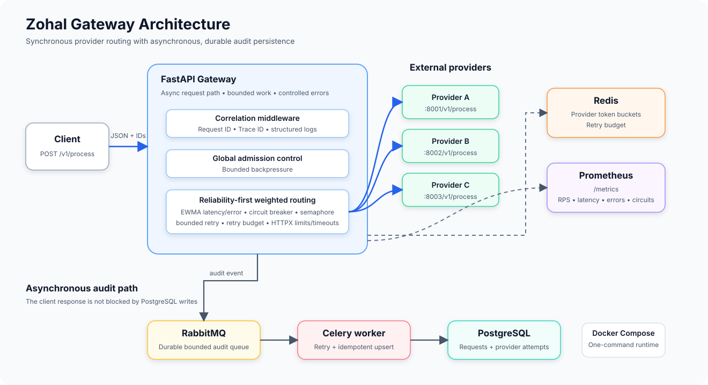
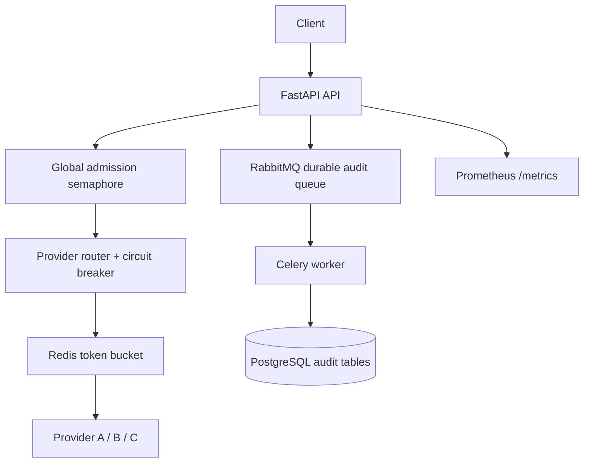

# Architecture

## Scope

The gateway accepts a JSON object, makes at most two upstream attempts across
exactly three providers, returns the resulting upstream response, and writes a
compact asynchronous audit record. It uses direct modules and process-local
routing state as deliberate time-boxed interview trade-offs.

Editable Mermaid source

## Request path

1. Middleware validates or generates `X-Request-ID` and `X-Trace-ID`, binds
   them through `contextvars`, logs completion, and records request metrics.
2. The process endpoint requires a JSON object and obtains a global bounded
   admission slot. Rejection returns `429` after at most 50 ms.
3. The router makes a weighted-random choice among positive weights:
   `0.50 * ((1 - error_ewma) ** 2) + 0.30 * latency_score + 0.20 * load_score`.
   A provider is unavailable when its circuit is open, its provider semaphore
   is full, or an upstream `429 Retry-After` cooldown is active. A Redis Lua
   token bucket gates each upstream call.
4. One lifespan-owned `httpx.AsyncClient` forwards JSON and correlation
   headers with 200 total / 100 keepalive connection limits and explicit
   connect/read/write/pool timeouts. It retries once at most, never on the
   same provider, only for timeout/network/429/5xx, and only when the Redis
   retry budget and overall deadline permit it.
5. The per-process breaker counts timeout, network, and 5xx failures: 20 calls,
   five minimum, 50% threshold, 15 seconds open, one half-open probe.
6. The API returns the upstream status/body or a controlled error with safe
   correlation headers, then publishes metadata without delaying that response.

## State and reliability boundaries

Redis is the shared token-bucket authority. It is unavailable →
`503 rate_limiter_unavailable`, preventing an unlimited fallback. In-flight
load, EWMA, circuits, and semaphores remain process-local, so replicas make
independent routing and breaker decisions.

RabbitMQ hosts a durable `audit` queue with maximum length 100,000 and
`reject-publish` overflow. Publisher confirms surface rejection; it is logged
and counted without changing an already-obtained upstream result. Celery only
persists audit data, using late acknowledgements, worker-loss rejection,
prefetch one, and up to three database retries.

PostgreSQL contains `requests` and `provider_attempts`. Upserts and unique
`(request_id, attempt_number)` make redelivery idempotent. Stored data is
correlation, timing, status, provider, error classification, payload size, and
payload SHA-256—not full payloads or responses.

## Operations and limits

`/health/live` tests only process liveness. `/health/ready` pings Redis and
reports RabbitMQ/PostgreSQL configuration without expensive dependency queries;
external provider downtime is intentionally excluded. `/metrics` supplies
bounded-cardinality Prometheus metrics, including timeout phase counts for
pool, connect, read, write, deadline, and other timeouts.

Compose runs the API, one migration job, Celery, Redis, RabbitMQ, and
PostgreSQL. The default provider URLs use the reserved `example.invalid` domain and are not
working endpoints; configure all three provider URL variables before sending traffic. Circuit state
remains per process, so replicas make independent breaker decisions. The demo
does not claim 10,000 RPS: that requires multiple API replicas, shared Redis
limits, independently scaled broker/workers, batched writes, PostgreSQL
partitioning, connection pools, and retention.
